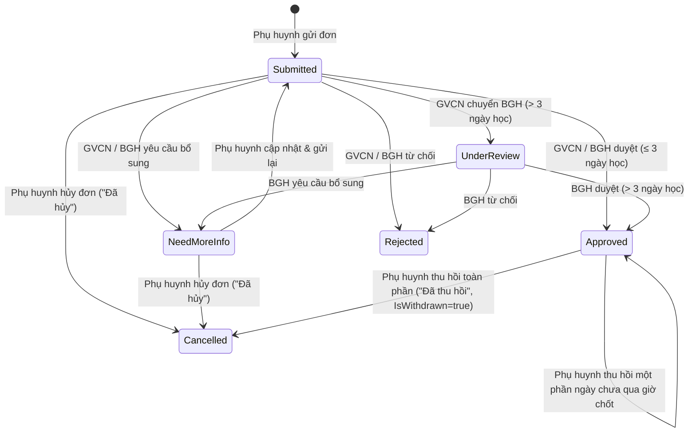

# Luồng Nghiệp Vụ Đơn Xin Nghỉ Học (Leave Request Flow)

Tài liệu mô tả đầy đủ vòng đời đơn xin nghỉ học trên hệ thống SAWP, bao gồm các tính năng bổ sung: **Chỉnh sửa đơn**, **Yêu cầu bổ sung thông tin**, **Thu hồi đơn đã duyệt** và **Lịch sử xử lý đơn**.

## 1. Vai trò tham gia
- **Phụ huynh (`Parent`)**: Tạo đơn, chỉnh sửa đơn đang chờ duyệt / yêu cầu bổ sung, hủy đơn chưa duyệt, thu hồi đơn đã duyệt trước giờ chốt, xem lịch sử xử lý.
- **Giáo viên chủ nhiệm (`Teacher`)**: Xem và xử lý đơn của lớp chủ nhiệm (phê duyệt/từ chối đơn ≤ 3 ngày học; xác nhận & chuyển Ban Giám Hiệu đơn > 3 ngày học; yêu cầu bổ sung thông tin).
- **Ban Giám Hiệu (`SchoolBoard`) / Quản trị (`Admin`)**: Xem toàn trường, phê duyệt/từ chối/yêu cầu bổ sung đơn chuyển cấp (> 3 ngày học) hoặc đơn cần can thiệp trực tiếp.

## 2. Trạng thái & Chuyển đổi trạng thái

> **Phân biệt hủy và thu hồi**:
> - **Đã hủy** (`Status = Cancelled`, `IsWithdrawn = false`): Phụ huynh tự hủy khi đơn ở trạng thái `Submitted` hoặc `NeedMoreInfo`.
> - **Đã thu hồi** (`Status = Cancelled`, `IsWithdrawn = true`): Phụ huynh thu hồi đơn sau khi đã được phê duyệt (`Approved`) cho các ngày chưa qua giờ chốt.

## 3. Quy tắc kiểm tra dữ liệu đầu vào
- **Thời gian nghỉ**: `StartDate >= Today`, `EndDate >= StartDate`, tối đa `30` ngày lịch và tối đa `15` ngày học thực tế (tính qua `SchoolCalendarHelper.IsSchoolDay`, tôn trọng ngày lễ và ngày học bù). Không cho phép trùng đơn đang hoạt động (`Submitted`, `UnderReview`, `NeedMoreInfo`, `Approved`) cùng học sinh và trùng buổi.
- **Lý do xin nghỉ**: Bắt buộc từ **5 đến 500 ký tự**.
- **Lý do từ chối / yêu cầu bổ sung**: Bắt buộc từ **5 đến 500 ký tự**.
- **Tệp minh chứng**: Tối đa 5 tệp, mỗi tệp ≤ 10MB, chỉ chấp nhận `.pdf`, `.jpg`, `.jpeg`, `.png` (BR-50). Tải qua `/api/LeaveRequests/upload-attachment` và truy cập có kiểm tra quyền qua `/api/LeaveRequests/attachment-file`.

## 4. Các luồng mở rộng

### 4.1. Chỉnh sửa đơn & Yêu cầu bổ sung thông tin (`PUT /api/LeaveRequests/{id}`)
- Phụ huynh được chỉnh sửa đơn khi `Status` là `Submitted` hoặc `NeedMoreInfo`.
- Khi `Status == NeedMoreInfo`:
  - Phụ huynh phải có ít nhất một thay đổi thực tế trước khi gửi lại.
  - Nếu ghi chú yêu cầu bổ sung từ GVCN/BGH nhắc đến giấy khám/minh chứng/đính kèm thì bắt buộc phải có tệp đính kèm hợp lệ trước khi gửi lại.
- Sau khi cập nhật thành công, đơn quay về `Submitted` và gửi thông báo tới GVCN.

### 4.2. Thu hồi đơn đã duyệt (`POST /api/LeaveRequests/{id}/withdraw`)
- Chỉ áp dụng cho đơn `Approved` còn ít nhất 1 ngày học chưa qua giờ chốt:
  - Buổi sáng / Cả ngày: trước giờ chốt bếp (`LunchServiceDay.CutoffTime`, mặc định `08:15`) và ngày bếp chưa khóa (`!IsLocked`).
  - Buổi chiều: trước `AfternoonCutoffTime` (mặc định `13:00`).
- Hệ thống tự động:
  1. Xóa bản ghi `AttendanceRecord` trạng thái `ExcusedAbsence` sinh tự động từ đơn đó cho các ngày thu hồi.
  2. Khôi phục suất ăn bán trú (`LunchRegistration`) nếu suất ăn đã bị hủy do đơn nghỉ (`CancellationSource == Leave`).
  3. **Thu hồi toàn phần** (tất cả ngày học đều chưa qua giờ chốt): chuyển đơn sang `Cancelled` với cờ `IsWithdrawn = true` (`StatusName = "Đã thu hồi"`).
  4. **Thu hồi một phần** (một số ngày đầu đã qua giờ chốt): rút ngắn `EndDate` về ngày cuối cùng đã qua giờ chốt và ghi nhật ký các ngày đã thu hồi.
  5. Ghi `AuditLog` (`LEAVE_REQUEST_WITHDRAW`) và thông báo tới GVCN.

### 4.3. Đồng bộ Điểm danh & Bán trú khi phê duyệt
- **Điểm danh**: Tự động tạo/cập nhật `ExcusedAbsence` cho các ngày học thực tế thuộc đơn. Không ghi đè nếu GVCN đã chấm `Present` hoặc `Late` (thay vào đó gửi cảnh báo xung đột cho GVCN).
- **Bán trú**: Chỉ tự động hủy suất ăn cho buổi Sáng / Cả ngày khi `KeepLunchService == false`, học sinh có đăng ký bán trú active, chưa qua giờ chốt và ngày bếp chưa khóa. Thông báo kết quả phân biệt rõ: nghỉ buổi chiều / chưa đăng ký bán trú / đã qua giờ chốt.

### 4.4. Lịch sử xử lý (`StatusHistory`)
- Tổng hợp trực tiếp từ `AuditLogs` của `AdministrativeRequest` theo thứ tự thời gian, hiển thị chính xác vai trò người thao tác (`Ban Giám Hiệu` vs `GVCN` vs `Phụ huynh`), thời gian (`dd-MM-yyyy`) và ghi chú từng bước.
